  

  

  

<table>
  <tr>
    <td width="50%" valign="top">
      <b>⚙️ 基础设施自动化</b> 
      PXE 网络批量装机 · 服务器初始化 · 配置下发
    </td>
    <td width="50%" valign="top">
      <b>🗄️ 存储与虚拟化</b> 
      Ceph 分布式存储实验 · 节点扩容 · 故障演练
    </td>
  </tr>
  <tr>
    <td width="50%" valign="top">
      <b>📊 Web 与可视化</b> 
      数字化大屏 · 云盘类应用 · 协作平台前端
    </td>
    <td width="50%" valign="top">
      <b>🧰 工具与脚本</b> 
      天气、汇率、推送机器人等日常效率工具
    </td>
  </tr>
</table>

  

<table>
  <tr>
    <td width="33%" valign="top">
      <b><a href="https://github.com/1351055318/Server-Configuration">Server-Configuration</a></b> 
      <code>Shell</code> 
      服务器初始化与配置脚本集合
    </td>
    <td width="33%" valign="top">
      <b><a href="https://github.com/1351055318/disk-pxe">disk-pxe</a></b> 
      <code>Shell</code> 
      PXE 网络批量装机方案
    </td>
    <td width="33%" valign="top">
      <b><a href="https://github.com/1351055318/test-ceph">test-ceph</a></b> 
      <code>Shell</code> 
      Ceph 分布式存储实验环境
    </td>
  </tr>
  <tr>
    <td width="33%" valign="top">
      <b><a href="https://github.com/1351055318/shuzihuadaping-test1">shuzihuadaping-test1</a></b> 
      <code>TypeScript</code> 
      数字化大屏可视化
    </td>
    <td width="33%" valign="top">
      <b><a href="https://github.com/1351055318/joke-sender">joke-sender</a></b> 
      <code>Python</code> 
      冷笑话 / 土味情话自动推送系统
    </td>
    <td width="33%" valign="top">
      <b><a href="https://github.com/1351055318/HUILV">HUILV</a></b> 
      <code>Python</code> 
      汇率查询工具 · MIT
    </td>
  </tr>
</table>

  更多见 <a href="https://github.com/1351055318?tab=repositories">全部 17 个仓库</a>

  

  

<table>
  <tr>
    <td width="33%" valign="top">
      <b>系统 &amp; 运维</b> 
      Linux · Bash · Shell · Nginx · Ceph
    </td>
    <td width="33%" valign="top">
      <b>语言</b> 
      Python · JavaScript · TypeScript · CSS
    </td>
    <td width="33%" valign="top">
      <b>工具</b> 
      Git · GitHub · VS Code · Docker
    </td>
  </tr>
</table>

  

  

  

